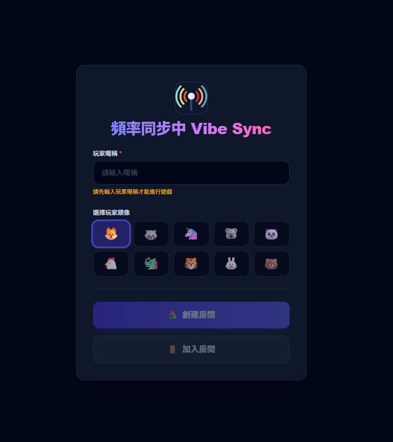
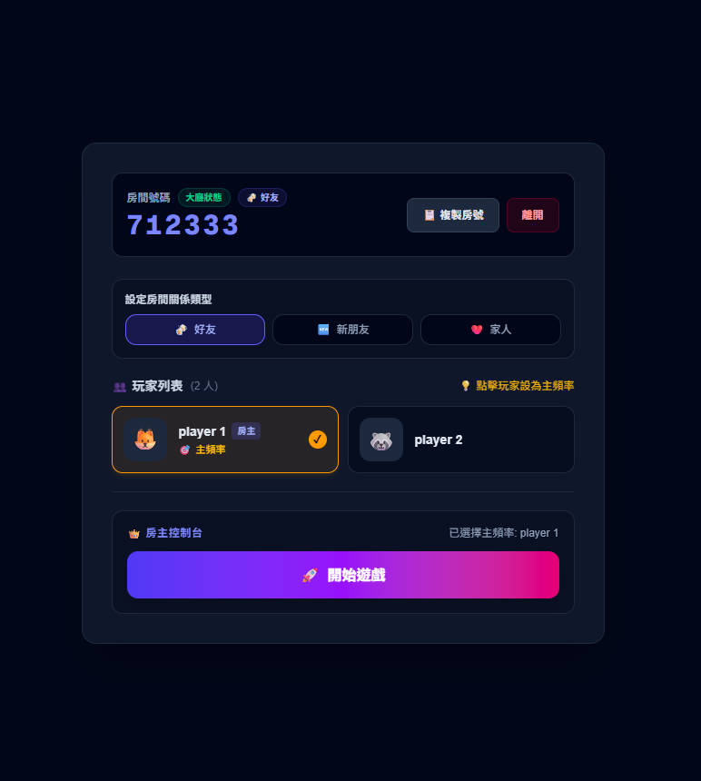
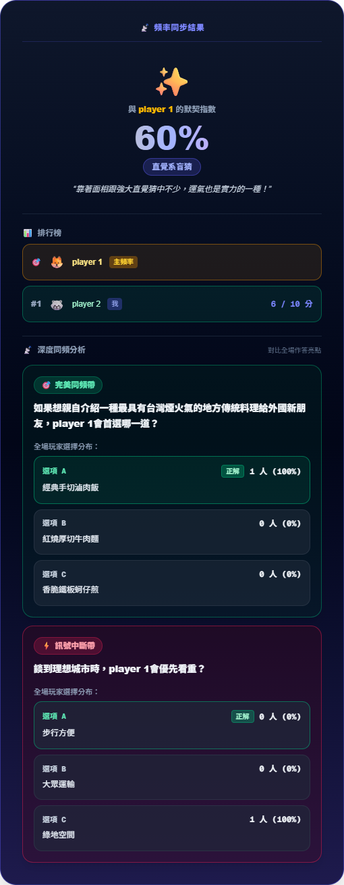
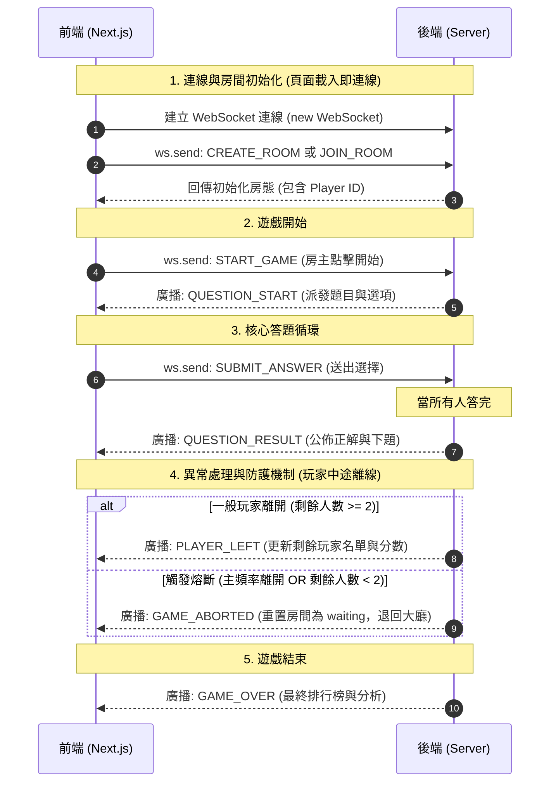

# Vibe Sync

這是一個即時多人默契問答的網頁遊戲。玩家們透過即時連線進入房間，由一位玩家擔任「主頻率」，其他人則透過猜測主頻率的選擇來測試彼此的默契指數！

### 核心功能

* **即時雙向互動**：基於 WebSocket 架構，支援多人即時加入、房號同步與答題狀態更新。
        

        
🔍 查看遊戲大廳畫面

         
        
        

* **多元關係模式**：支援「好友 (🍻)」、「新朋友 (🆕)」與「家人 (❤️)」三種關係類型設定。
        

            
🔍 查看房間等待畫面

             
        
        

* **結果分析**：提供深度同頻分析與排行榜數據，視覺化呈現玩家之間的默契指數、答題亮點及全場作答分布。
        

        
🔍 查看同頻分析畫面

         
        
        

### 系統流程圖

